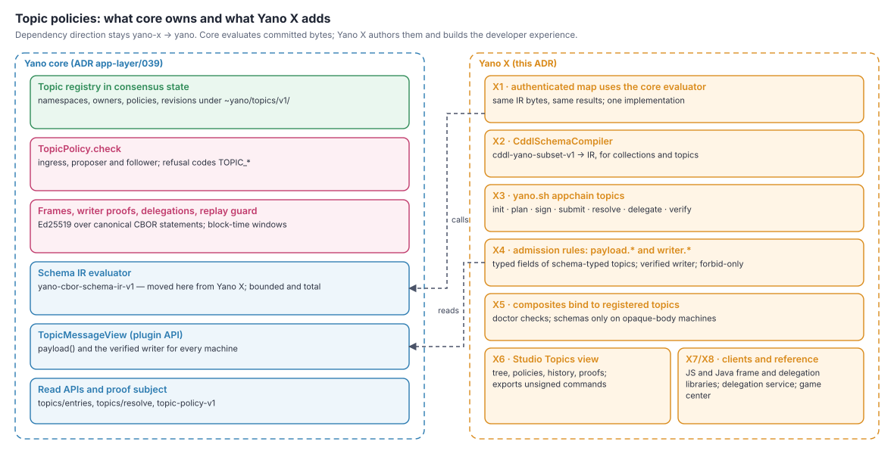
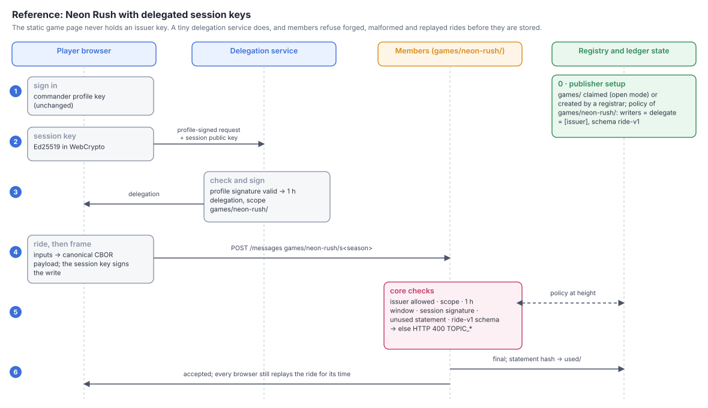

# ADR app-layer/038: Topic Policies in Yano X — Schemas, Admission Rules, Tooling and Delegated Clients

**Status:** Proposed — design only, for review. No implementation is part of this ADR.
**Date:** 2026-10-22
**Scope:** How Yano X adopts the core topic registry: one schema engine, admission rules over typed
topic payloads and verified writers, composites bound to registered topics, authoring tools, client
libraries for frames and delegations, and the reference example.
**Depends on:** core [Yano ADR app-layer/039](https://github.com/bloxbean/yano/blob/main/adr/app-layer/039-topic-registry-namespaces-and-writer-policies.md)
(topic registry, namespaces and writer policies; under review in
[bloxbean/yano#197](https://github.com/bloxbean/yano/pull/197)); Yano X ADR app-layer/025.1, 031, 031.3, 031.4.
**Risk:** Medium. No new consensus rules of its own, but it changes the authenticated map's schema
dependency and the admission-rule views, both of which feed consensus decisions.
**Numbering:** local to `adr/app-layer`; the root-level ADR-038 (documentation site) is a separate
series.
**Preview reset policy:** app chains are unreleased; no compatibility adapters.

---

## 1. Context

Core ADR-039 gives every Yano app chain an opt-in topic registry in consensus state: namespaces with
owners, four creation modes, per-topic writer policies, short-lived delegations (session keys), and
optional canonical-CBOR schemas checked with the `yano-cbor-schema-ir-v1` evaluator, which it moves
from Yano X into core. Core deliberately stops at the framework boundary: it does not author
schemas, edit policies, or know about composites and admission rules.

Yano X owns those parts today:

- `AuthenticatedMapSchema` (`state-machines/stdlib-contracts`) — the IR contract and evaluator that
  core adopts.
- `AuthenticatedMapCddlCompiler` (`tooling/devtools`) — `cddl-yano-subset-v1` → IR.
- Declarative composites, where each component is already bound to a topic
  (`components[].topic`, e.g. `examples/bindings/dpp-namespace-isolation.yaml`).
- Admission rules (ADR-031.3/031.4), which can read `command.*` only for command-selectable
  kernels, `context.{height, sender, derived, depth, binding}`, `params`, `config`, `facts`,
  `reads` and the authenticated-map write view. They cannot read evidence or a timestamp, and they
  see nothing of an `ordered-log` body, which is opaque.
- The `yano.sh appchain` CLI, Studio, the stdlib machines, the docs and the examples.



## 2. Decisions

### X1 — One schema engine: the authenticated map uses the core evaluator

- Remove the evaluator from `stdlib-contracts` and call core's `yano-cbor-schema-ir-v1` evaluator.
  The IR id, version, limits and bytes stay identical, so existing collection schemas and genesis
  files keep their meaning (V1).
- `AuthenticatedMapSchema` shrinks to the collection-specific glue (encoding checks, error codes
  `VALUE_ENCODING` / `VALUE_SCHEMA`), or disappears if nothing collection-specific remains.
- The Yano X release that does this pins a Yano host with the core evaluator (an API-level bump).

### X2 — One CDDL compiler for collections and topics

- Rename `AuthenticatedMapCddlCompiler` to a neutral `CddlSchemaCompiler` in `tooling/devtools`
  (no behaviour change) and use it for both authenticated-map collections and topic schemas.
- The compiler stays a tool: members never compile CDDL; they evaluate committed IR.

### X3 — CLI: `yano.sh appchain topics`

A new command group that prepares, signs and submits registry commands without the user handling
CBOR:

| Command | Does |
|---|---|
| `topics init <namespace>` | writes a local `topics.yaml` (owners, policies, schemas as CDDL) |
| `topics plan` | compiles schemas, resolves inheritance, shows the exact registry commands and their effect |
| `topics sign --key-file <f>` | adds an owner, registrar or issuer signature (keys by file only, never on the command line) |
| `topics submit --peer <url>` | submits to `~topics/registry`, or prints the governance command for members |
| `topics resolve <topic>` | the effective policy and the entry it came from, with a `topic-policy-v1` proof |
| `topics delegate` | issues a delegation for a session key (for testing and small deployments) |
| `topics verify <messageId>` | offline authorship proof: message proof + frame + policy proof at its height |

Owner keys can be split across machines: `plan` produces an unsigned command file that each owner
signs until the threshold is met (k-of-n).

### X4 — Admission rules see typed payloads and the verified writer

ADR-031.3 rules gain two read-only views when the core topic registry is enabled:

- `payload.<field>` — for a topic with a schema whose root is a text-keyed map, its first 32
  top-level scalar members (the same projection rule the authenticated-map value view already uses
  in ADR-031.4). This makes rules work on `ordered-log` components for the first time.
- `writer.key`, `writer.delegated` and `writer.issuer` — from core's verified writer. Raw signatures
  remain unreadable (`RULE_EVIDENCE_READ` stands).

Rules that read only `payload` and `params` are static and refuse at ingress, like today's static
rules. Order is fixed: the core topic policy runs first, then the machine's own admission, then the
component's rules. Policies and rules both only forbid (core I10).

Example (illustrative):

```yaml
components:
  - id: rides
    machine: ordered-log
    topic: games/neon-rush/rides
    admission:
      - rule: ride-bounds
rules:
  - id: ride-bounds
    deny: RIDE_OUT_OF_BOUNDS
    require:
      - expr: 'payload.frames >= 1200 && payload.frames <= 9000'
      - expr: 'writer.delegated'          # only session keys issued by the game service
```

### X5 — Composites bind to registered topics

- A composite component's `topic:` must be covered by a registry entry when the chain has
  `unregistered-topics: reject`, and `appchain doctor` warns otherwise.
- Composite validation checks that a component's command format is compatible with its topic's
  schema: a schema on a typed-kernel topic (for example `balances`) is refused, because those
  kernels define their own command codec; schemas are for opaque-body machines and plugins.

### X6 — Studio and the consoles

- A **Topics** view: the namespace tree, each entry's owners, writers, delegators, schema and
  revision history, and a `topic-policy-v1` proof for any entry at any height.
- A policy editor that produces the same `topics.yaml` and plan as the CLI. Studio never holds or
  requests private keys; it exports unsigned commands for the CLI or an external signer.

### X7 — Client libraries for frames and delegations

- **JavaScript** (browser-first, WebCrypto Ed25519, no dependencies), published with the examples:
  build a frame; sign a write statement; create a session key; request, store and refresh a
  delegation; parse refusal codes.
- **Java**: the same in `:sdk:client`, for services that issue delegations.
- Both ship with the core test vectors (core V2) and pass them in CI.

### X8 — Reference: a delegation service and the game center

Static sites cannot hold an issuer key, so the reference adds a tiny **delegation service** (one
endpoint, any serverless runtime) and uses it in the game center example:

1. The game publisher owns `games/` (claimed in `open` mode on the local cluster; created by
   governance or a registrar on the showcase).
2. It creates `games/neon-rush/` with `writers: {threshold 1, keys: [issuer]}` and
   `delegate: [issuer]`, a ride schema, and `maxDelegationMs: 3600000`.
3. A player signs in with their commander profile (unchanged); the page creates a session key and
   asks the delegation service for a one-hour delegation scoped to `games/neon-rush/`. The service
   checks the commander's profile signature before signing.
4. Rides are framed and signed with the session key and submitted to any member. Forged,
   malformed and replayed rides are refused at the door and never stored.



What it still cannot do — and the docs say so: verify the ride time (browsers still replay the
inputs), or tell a bot from a human.

### X9 — Docs and inventory

- A task guide "Protect a topic and give users session keys", a concept page on namespaces and
  delegations, and updates to the admission-rules chapter (payload and writer views).
- `config/artifacts-v1.json` changes only if X7's JavaScript library becomes a published artifact
  (OQ-X3).

## 3. Invariants

| ID | Invariant | Decisions |
|---|---|---|
| IX1 | Existing authenticated-map schemas accept and reject exactly the same values before and after X1. | X1 |
| IX2 | The CLI and Studio produce byte-identical registry commands from the same `topics.yaml`. | X3, X6 |
| IX3 | `payload.*` and `writer.*` are read-only, derived from core's verified view, and never expose signatures. | X4 |
| IX4 | No Yano X tool or UI ever transmits a private key; keys are read from files or external signers only. | X3, X6, X7 |
| IX5 | Client libraries reproduce every core test vector byte for byte. | X7 |

## 4. Alternatives considered

| Alternative | Why not |
|---|---|
| Keep a second evaluator in Yano X | Two implementations of a consensus-relevant predicate drift apart; core already needs one. |
| A Yano X `schema-log` machine instead of core topic schemas | Covers logs only; superseded by core ADR-039. |
| Let Studio sign registry commands with a stored key | ADR-053 keeps signing in a signing gateway or a key the user holds in their own browser session; a stored owner key in Studio would be a new, long-lived secret in a product. |
| Put the delegation service inside the node | Members must not hold application issuer keys; delegations are an application concern. |

## 5. Milestones

| ID | Scope | Entry gate | Exit |
|---|---|---|---|
| MX1 | X1, X2: evaluator switch and compiler rename | core M4 released and pinned | IX1 via the existing authenticated-map schema vectors |
| MX2 | X7 client libraries | core M1 vectors frozen | IX5 |
| MX3 | X3 CLI and X5 composite checks | core M3 released and pinned | IX2; doctor checks; a 3-node cluster scenario |
| MX4 | X4 admission-rule views | core M5 released and pinned | IX3; rule vectors replayed offline |
| MX5 | X6 Studio, X8 reference, X9 docs | MX3, MX4 | the game-center scenario passes end to end; docs published |

## 6. Verification

- **V1:** the full authenticated-map schema test corpus passes unchanged against the core evaluator.
- **V2:** CLI, Studio and both client libraries reproduce core's frame, delegation and command
  vectors.
- **V3:** rule-view tests: payload projections, writer fields, static-rule ingress refusals, and
  order of evaluation (policy → machine → rules).
- **V4:** the reference game-center scenario on a 3-node cluster: delegation issue, ride accepted,
  forged / replayed / expired / out-of-scope rides refused, issuer rotation, recovery drill.

## 7. Open questions

| ID | Question | Lean |
|---|---|---|
| OQ-X1 | Should `payload.*` project nested fields or arrays? | No in v1; match the authenticated-map value view. |
| OQ-X2 | Where does the reference delegation service live? | In `yano-x-examples`, not in the distribution. |
| OQ-X3 | Publish the JavaScript client as an npm artifact now? | Not until core formats are frozen (core M1). |

## Revision history

- r1 (2026-10-22): initial proposal, companion to core ADR app-layer/039 r1.
