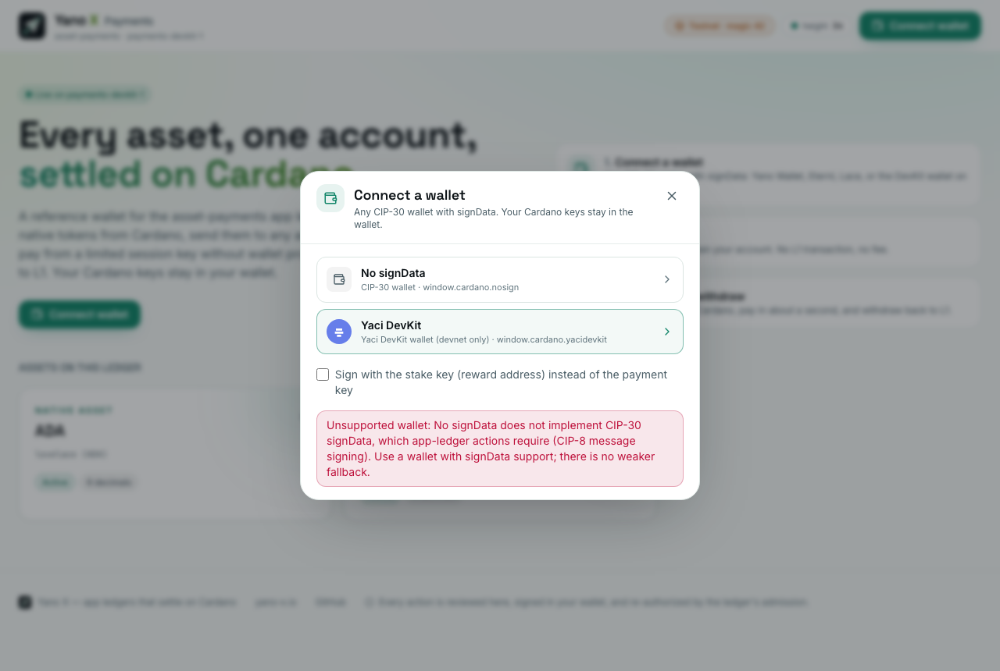
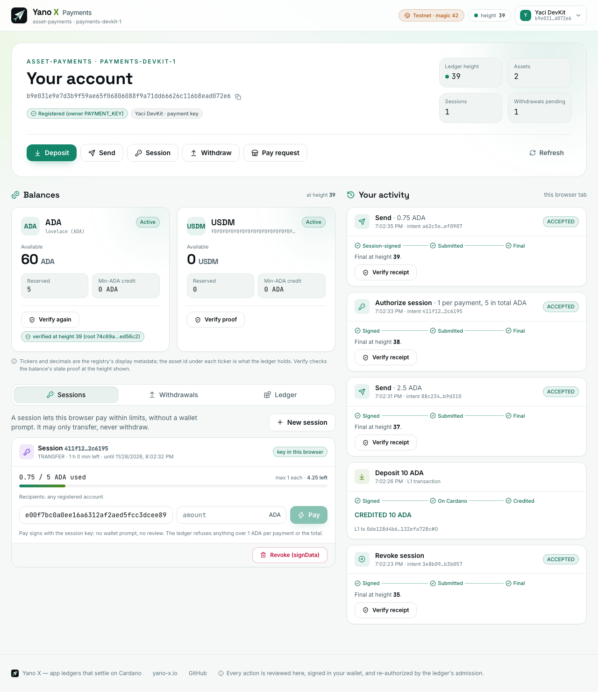
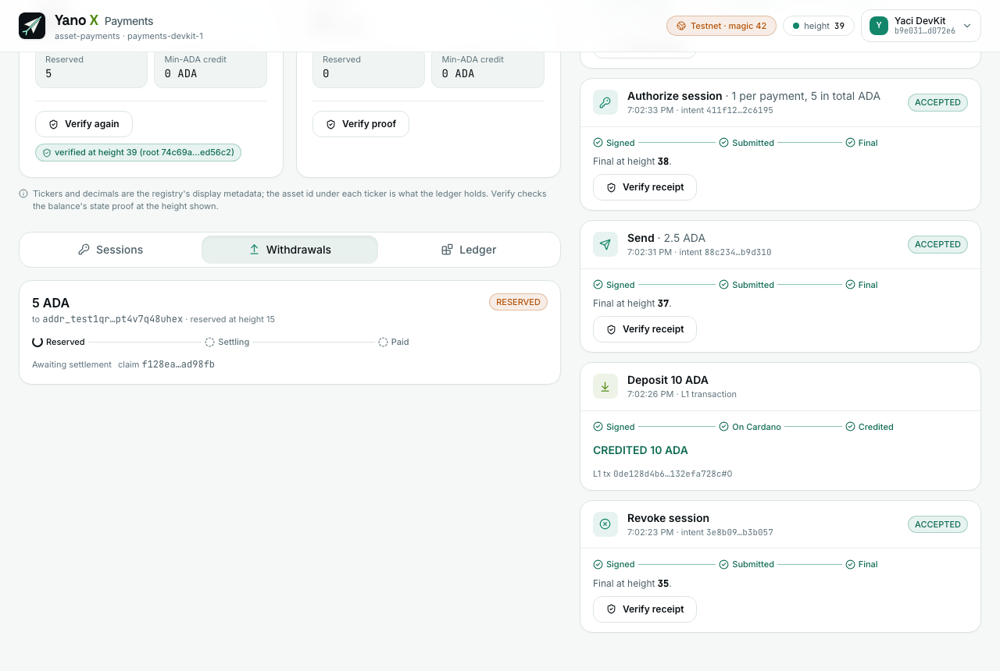
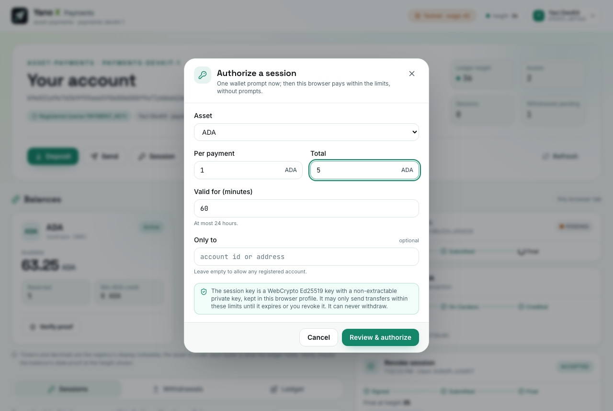
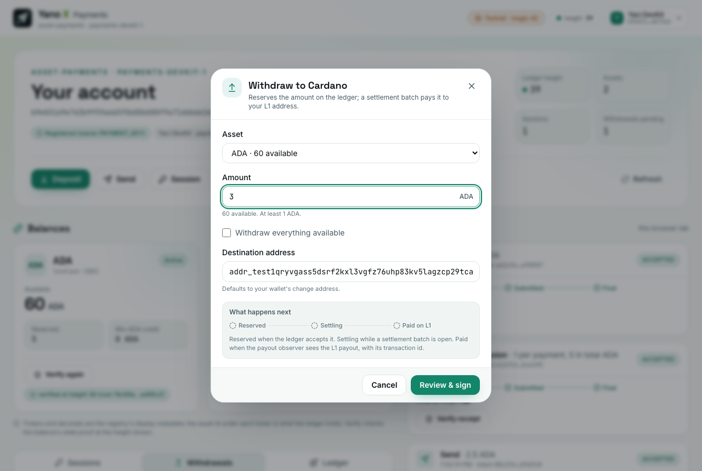
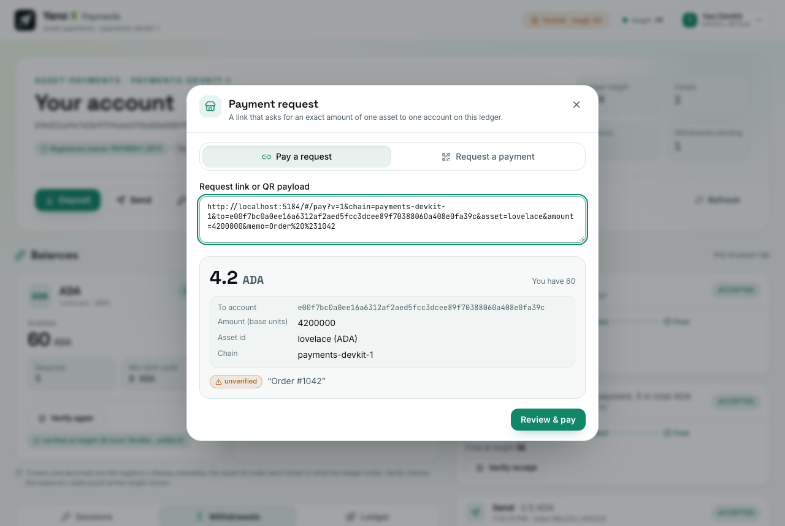
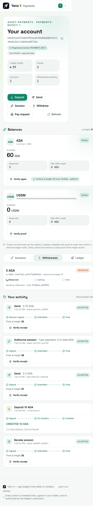

# Payments reference client

A small web client for the `asset-payments` app ledger (issue #109 §3.1 and §7,
ADR-059 D13 and D14). It uses only standard CIP-30 calls, so an existing Cardano
wallet can register an account, deposit from L1, transfer, authorize and revoke a
session key, pay with that session key without a wallet prompt, and request
withdrawals. You don't need a Yano X wallet, and your Cardano keys stay in your
wallet.

| Operation | What the wallet does | How it reaches the ledger |
|---|---|---|
| Register | CIP-30 `signData` (CIP-8) | message on `asset-payments.intents` |
| Deposit | CIP-30 `signTx`, then `submitTx` | L1 transaction to the vault, credited by the deposit observer |
| Transfer | `signData` | message |
| Authorize or revoke a session | `signData` | message |
| Pay with a session | nothing: the browser's session key signs | message |
| Withdraw | `signData` | message; settlement pays it on L1 |

Network names are never hard-coded. The client reads the chain's intent domain
from the node and refuses a wallet whose `getNetworkId()` doesn't match the
chain's address network id. The same build works against a devnet, preview,
preprod or mainnet node.

## Screens

The client is a single-page React app styled as a sibling of the Yano X client
showcase: the same light Yano X brand tokens, type (Inter, Space Grotesk,
JetBrains Mono), cards, badges and header.

| Screen | What it shows |
|---|---|
| Welcome | The chain, its network badge (from the intent domain) and the assets in the vault registry, with a Connect button. |
| Wallet picker | Every CIP-30 wallet injected into the page (`yano`, `yacidevkit`, Eternl, Lace, ...), the stake-key option, and the "Unsupported wallet" message for a wallet without `signData` or on another network. |
| Onboarding | Registration as one step: sign a message, no L1 transaction and no fee. |
| Dashboard | The account, per-asset balance cards (available, reserved with a "partial" badge, min-ADA credit, registry status, the full asset id and a **Verify proof** button), action buttons, and tabs for sessions, withdrawals and the ledger (intent domain and vault registry, each vault with its proof). |
| Activity | Every action this tab submitted, followed to its receipt (`ACCEPTED`, `REJECTED <reason>` with a readable explanation, or `EXPIRED`) or deposit record, with a **Verify receipt** button. |
| Deposit | Asset and amount, then the review decoded from the transaction, `signTx`, and a status that follows the deposit to `CREDITED`. |
| Send | Recipient (account id or address), asset and amount, then the review. |
| Session | Limits and expiry, one wallet prompt. The session card shows used and remaining limits, pays without a prompt, and has **Revoke**. |
| Withdraw | Amount (or everything available), destination address and the `RESERVED` -> `SETTLING` -> `PAID` tracker, with the L1 payout tx link. |
| Pay request | Paste a payment request link (or its QR payload) to preview and pay it, or make a link for your own account. |
| Review sheet | The last step before every wallet prompt (see below). |

| | |
|---|---|
|  |  |
|  |  |
|  |  |
|  |  |
|  |  |
|  |  |



### Payment requests

A payment request is a link that asks for an exact amount of one asset to one
account on one chain:

```
<client>#/pay?v=1&chain=<chainId>&to=<accountId>&asset=<lovelace | policyId.assetNameHex>&amount=<base units>&memo=<text>
```

The amount is in base units and the asset is the full asset id, so a link
doesn't depend on the node's display metadata. The client refuses a link for
another chain, for an asset this ledger has no vault for, or for your own
account. Paying it is an ordinary owner-signed transfer with the usual review.
The memo is the requester's own text: it appears as "unverified" and isn't
signed. Opening the client with such a link opens the pay sheet once the
account is registered.

## Stack and layout

React 19, Vite, Tailwind CSS 4 (`@tailwindcss/vite`), TanStack Query,
lucide-react and clsx, with TypeScript, at the exact versions in
`package.json`. The UI never decides what is signed: that logic is plain
TypeScript.

| Path | Role |
|---|---|
| `src/lib/` | The tested logic: the intent encoder, CBOR, COSE, deposit verification, CIP-30 wallet access, session keys, proof binding, configuration and the API client. Also readable error codes (`errors.ts`) and payment request links (`payrequest.ts`). |
| `src/flows.ts` | Every action, independent of the UI: the intent pipeline (encode, cross-check, review, sign, pre-check, submit), deposit build and verification, sessions, proofs. |
| `src/state.tsx` | Configuration, chain, wallet and account state, the polled views, the activity this tab submitted, toasts and the pending review. |
| `src/components/` | Screens, flow sheets and the review sheet. |
| `src/ui.tsx`, `src/index.css` | UI primitives and design tokens, adapted from the client showcase. |

Every read goes through TanStack Query. Receipts, deposit records and
withdrawals keep polling, also in a background tab, until they reach a terminal
state (a receipt, a deposit record, `PAID`), so a status never stops half way.

## How an action is signed

1. The client encodes the `IntentEnvelopeV1` itself (`src/lib/intents.ts`). The
   encoder is tested byte for byte against the Java vectors in
   `ledgers/asset-payments/ledger/src/test/resources/asset-payments/intent-vectors-v1.json`.
2. It asks the node's `intents/encode` route to encode the same intent, and
   refuses to sign if the two encodings differ.
3. It shows the review sheet with the fields that matter: action, the amount in
   display units and in base units, the full asset id (`policyId.assetName`
   hex), the recipient, the account, the chain id, genesis id and network of the
   intent domain, and the expiry. The base units and asset id are what the
   ledger executes, so a node that lies about a ticker or decimals shows up here.
   The exact bytes are under a disclosure.
   Wallets show a `signData` payload as hex, not as a Cardano transaction. Check
   the fields in this sheet before you approve. Values are never shortened in
   the review.
4. The wallet signs (`signData(address, envelopeHex)`). Before submitting, the
   client checks that the COSE_Sign1 payload is exactly the envelope and that its
   protected `address` is the account's signing address.
5. The `intents/message` route wraps the signature as a `PaymentsMessageV1` and
   pre-checks it the way the ledger's admission will (advisory, against this
   node's committed state and clock). The client compares the wrapped bytes with
   its own wrapping.
6. The client submits through the host's ordinary SUBMIT route,
   `POST /api/v1/app-chain/chains/{chain}/messages`, where the ledger's admission
   authorizes the intent again. The domain API can't submit: the host gives
   domain APIs no submission.
7. The client polls `receipts/{intentId}` until the receipt is committed. A
   receipt is `ACCEPTED` or `REJECTED` with a reason, shown with a readable
   explanation (`src/lib/errors.ts`). An intent that never executes has no
   receipt and expires.

A session payment skips steps 3 and 4: the browser's session key signs, with no
review and no wallet prompt, and the grant's limits bound it.

Session keys are WebCrypto Ed25519 keys with a non-extractable private key. They
are kept in this browser profile's IndexedDB. A grant allows only `TRANSFER`,
within its per-payment and total limits, until its expiry (at most 24 hours in
this client) or until the owner revokes it. A session can never withdraw. The
client deletes a local key once its grant has expired, was rejected or revoked,
or its authorizing intent expired unexecuted.

## How a deposit is checked

The domain API builds the unsigned deposit, but the client doesn't trust it. Before
the wallet's `signTx`, `src/lib/deposit.ts` decodes the CBOR and refuses it
unless:

- every input is one of the wallet's own `getUtxos()` UTxOs;
- exactly one output pays the vault address from the vault registry the client
  read at startup from the configured node, not the build response;
- that output carries the exact `DepositDatumV1` the client computes itself
  (beneficiary account, refund address and refund key hash), and exactly the
  vault's asset in the requested quantity;
- every other output pays the wallet's change address, with no datum or script;
- the body has only inputs, outputs, fee, TTL and validity start: no
  certificates, withdrawals, mints, collateral or required signers;
- the fee is at most `maxDepositFeeLovelace` and a TTL is set.

The client computes the transaction id itself. The review shows the decoded
values, not the API's summary.

## Payments domain API

The API is served by the `org.yanoproject.x.asset-payments` bundle at
`/api/v1/plugins/org.yanoproject.x.asset-payments/chains/{chain}/payments/`.
Every route is `READ`. Amounts are decimal strings. Every fact carries its state
key, value and `proofPath`: the host's native proof route, relative to `/api/v1/`,
pinned to the committed height the answer was read at.

| Method and path | Returns |
|---|---|
| `GET info` | Intent domain, topic, TTL, vaults (asset id, ticker, decimals, status, address), withdrawal settings, domain status |
| `GET accounts/{accountId}` | Owner credential; per vault: available, reserved, reserved min-ADA, min-ADA credit, each with its proof |
| `GET accounts/{accountId}/sessions` | Grants with key, actions, limits, used and remaining amounts, expiry |
| `GET accounts/{accountId}/withdrawals?before=&limit=` | The account's claims, newest first: amount, recipient, `RESERVED` / `SETTLING` / `PAID` / `PAID_MISMATCH`, L1 payout tx id |
| `GET addresses/{addressHex}` | Credential kind, key hash and the account id it owns |
| `GET receipts/{intentId}` | Receipt (outcome, reason, height) or `found: false`; for an accepted withdrawal, its claim |
| `GET withdrawals/{claimId}` | One claim and its lifecycle |
| `GET vaults/{vaultId}/deposit-instructions?address=&account=` | Vault address and exact inline datum. Refused while the beneficiary is unregistered. |
| `GET vaults/{vaultId}/deposits/{txId}/{index}` | Deposit record: `CREDITED`, `UNCREDITED` with a reason, and so on |
| `POST deposits/build` | Unsigned deposit transaction CBOR built from the wallet's `getUtxos()` |
| `POST intents/encode` | Canonical envelope bytes and intent id for a JSON-described intent |
| `POST intents/message` | `PaymentsMessageV1` body for a `signData` result or a session signature, after an advisory authorization pre-check |

`SETTLING` means the claim is in a settlement batch whose result isn't recorded
yet. It is telemetry, not a consensus status. `PAID` is set only by the payout
observer, and the L1 payout transaction id comes with it.

The `deposits/build` body is
`{vaultId, quantity, lovelace?, changeAddress, utxos: [cip30 utxo hex], beneficiaryAccount?}`.
Fees use the linear fee rule, priced with the node's current L1 protocol
parameters, and count one witness per payment key of the inputs actually spent.
The transaction is valid until two hours of slots past the node's L1 tip. The
route refuses to build without a known tip (`L1_TIP_UNKNOWN`) or protocol
parameters (`L1_PARAMETERS_UNAVAILABLE`).

`deposit-instructions` and `deposits/build` refuse a vault whose
`activeFromSlot` the L1 tip hasn't reached (`VAULT_NOT_ACTIVE`), and a datum
larger than the deposit observer reads (`observers.<id>.datum.max-bytes` and
`datum.max-depth`, `DATUM_TOO_LARGE`). `info` reports both bounds as
`depositDatumBounds`.

An accepted withdrawal's receipt names its claim through the ledger's
`intent-claim/<IntentId>` entry, with that entry's proof as `intentLinkProof`.

## Run it

You need Node 22 and npm.

```bash
cd examples/payments-client
npm ci --legacy-peer-deps
npm test                    # unit and component tests, including the Java intent vectors
npm run check               # tsc --noEmit
npm run build               # type-check and build into dist/
PAYMENTS_NODE_URL=http://localhost:7470 npm run dev   # http://localhost:5174
```

`--legacy-peer-deps` works around an npm 10 resolver error on this dependency
set; it changes no version. Set `PAYMENTS_CLIENT_PORT` to use another port than
5174.

The dev server proxies `/api` to `PAYMENTS_NODE_URL`, so the node needs no CORS
setup. Configuration lives in the deployed `public/payments-client.json`. A built
client reads the node and the DevKit SDK only from that file. Only the dev
server (`npm run dev`) honours the `node` and `devkit` URL parameters, because a
link that sets them could point the page at another node or load a script next
to the stored session keys.

| Key | URL parameter | Meaning |
|---|---|---|
| `nodeUrl` | `node` (dev server only) | Node API base. The default is `/api/v1` (proxied). |
| `chainId` | `chain` | Chain id. If empty, the first hosted payments chain is used. |
| `apiKey` | | Topic-scoped submit key, when the node requires one (`yano.app-chain.api.keys=key=asset-payments.intents`). It is sent only to `nodeUrl`'s origin, including on chain discovery, and never to a node a URL parameter chose. |
| `devkitWalletSdkUrl` | `devkit` (dev server only) | Loads Yaci DevKit's wallet SDK. Devnet only. |
| `explorerTxUrl` | | L1 explorer link template, with `{tx}` |
| `networkLabel` | | Display label only |
| `maxDepositFeeLovelace` | | The highest deposit fee the client lets a wallet sign. The default is `2000000`. |

### Devnet with Yaci DevKit

1. Start Yaci DevKit (`devkit start`, then `create-node` in the DevKit shell).
   Its built-in CIP-30 wallet runs at <http://localhost:10000/wallet> with
   pre-funded devnet accounts. Its SDK injects `window.cardano.yacidevkit`.
2. Build and unpack the JVM distribution, then start one Yano X node that
   follows DevKit's cardano-node and hosts an asset-payments chain:

   ```bash
   ./gradlew :distribution:jvm:yanoXJvmDistZip -PskipSigning=true
   unzip distribution/jvm/build/distributions/yano-x-jvm-<version>.zip -d /tmp/payments
   DIST=/tmp/payments/yano-x-jvm-<version> RUN=/tmp/payments/run \
     examples/payments-client/e2e/devkit-node.sh start
   DIST=... RUN=... examples/payments-client/e2e/devkit-node.sh status
   ```

   The script copies DevKit's genesis files out of its container
   (`DEVKIT_CONTAINER`, `node1-yaci-cli-1` by default). It runs a single-member
   chain with an ADA vault and a display-only USDM vault. The vault script isn't
   deployed, so devnet ADA sent to the vault stays there. A payout observer id is
   configured but no observer runs, so withdrawals reserve and stay `RESERVED`.
   Paying them needs the full gateway deployment (`qa/harness/asset-gateway`).
3. Open
   `http://localhost:5174/?devkit=http://localhost:10000/wallet-sdk.js` on the dev
   server. For a built client, set `devkitWalletSdkUrl` in `payments-client.json`
   instead.
   The DevKit wallet uses its active account. To act as another account, switch
   accounts on the wallet page (or
   `PUT /api/v1/wallet/active-account {"accountId": "1"}`) and connect again.

### Yano Wallet

[Yano Wallet](https://devkit.yaci.xyz/yano-wallet) is a desktop wallet backed by
DevKit's Yaci Store. Its connector extension injects `window.cardano.yano`, and
the client lists it like any other CIP-30 wallet. Point the wallet at the same
DevKit, then open the client without the `devkit` parameter.

### Preview and preprod (later)

Run a node against the public network with a funded gateway deployment. Serve
the client from the same origin as the node's API, or set `nodeUrl` and allow
the client's origin in the node's CORS configuration. Eternl and Lace inject
`window.cardano.eternl` and `window.cardano.lace`.

## Tests

`npm test` runs the unit tests (vitest) and the component tests
(Testing Library with jsdom): the intent encoder against the Java vectors,
deposit verification, the proof binding, session pruning, configuration,
payment request links and error texts; the intent pipeline refusing an intent
the node encodes differently or a prepared message that isn't the signed one;
the review sheet showing the decoded values in full (base units, asset id,
chain, genesis); and the wallet picker's unsupported-wallet messages.

## End-to-end test

`e2e/payments.spec.ts` drives the client with the DevKit wallet. It covers
registering two accounts, a 25 ADA deposit (`signTx`) credited by the observer,
a transfer, a payment request made by one account and paid by the other, a
session (one payment without a wallet prompt, one refused with
`SESSION_LIMIT`, then a revoke), a withdrawal shown as reserved, verified
balance and receipt proofs, and the unsupported-wallet message. It skips itself
when DevKit or the node isn't reachable. Wait until the node has caught up with
DevKit's L1 tip before you run it (compare `GET /api/v1/node/tip` with DevKit's
tip); a node that is still syncing refuses deposits with `L1_TIP_UNKNOWN` or
credits them late.

```bash
npx playwright install chromium   # once
PAYMENTS_NODE_URL=http://localhost:7470 npm run test:e2e
PAYMENTS_NODE_URL=http://localhost:7470 npm run screenshots   # refreshes docs/screenshots
```

The screenshot run (`e2e/screenshots.spec.ts`) expects the E2E to have run
first, so DevKit accounts 0 and 1 are registered; it leaves account 2
unregistered for the onboarding screen.

## Wallet compatibility

Every entry is **untested** until the interoperability track runs it. Record the
wallet version, the credential that signed (payment or stake key), and how
rejection, hardware and mobile behave.

| Wallet | Version | `signData` (payment key) | `signData` (stake key) | `signTx` deposit | User rejection | Hardware | Mobile | Status |
|---|---|---|---|---|---|---|---|---|
| Yaci DevKit wallet | 0.12.0 | swapped arguments (see below) | | | n/a | n/a | n/a | untested |
| Yano Wallet | | | | | | | | untested |
| Eternl | | | | | | | | untested |
| Lace | | | | | | | | untested |
| Yoroi | | | | | | | | untested |

Known quirk: Yaci DevKit 0.12.0's wallet backend (`/api/v1/wallet/sign-data`)
puts the payload in the protected `address` header and signs the address as the
payload. For the DevKit wallet (`window.cardano.yacidevkit`) only, the client
detects this from the wallet's own output, retries once with the arguments
swapped, and checks the result like any other signature. Any other mismatch is
refused, and nothing is submitted.

A wallet without `signData` gets an "Unsupported wallet" message. The client has
no weaker fallback. Script addresses and Byron addresses have no key a CIP-30
wallet signs with, so they can't own an account.

## Limits of this client

- Proofs: **Verify** fetches the native proof of the shown key at the view's
  committed height, from a route the client builds itself. It requires the
  proof's key, value, height and state root to be the view's, and asks the
  node's `proof/verify` route to verify it against the view's root. A proof at
  another height isn't verified. For an independent check, verify the proof
  yourself with `sdk/proof-verifier`, against a root you trust (for example the
  L1 anchor), rather than against the node that served it.
- The account view sums reserved amounts from up to 8 pages of 64 matching
  claims, at most 2,048 claims scanned per page. `reservedFrom.complete` says
  whether that covered every claim; the client labels an incomplete total
  "partial".
- Activity lives in this browser tab's memory: a reload starts an empty feed
  (balances, sessions and withdrawals are read from the ledger again).
- A payment request is shown as a link to copy; the client doesn't draw QR
  codes (any QR generator can encode the link).
- No owner rotation UI. `ROTATE_OWNER` needs two wallets to sign the same
  envelope; the encoder and the API support it. After a rotation, connect the new
  owner's wallet, open **Account details** from the account menu and enter the
  account id under **Act for another account**. The client
  acts for it only if the account's committed owner is the connected credential.
